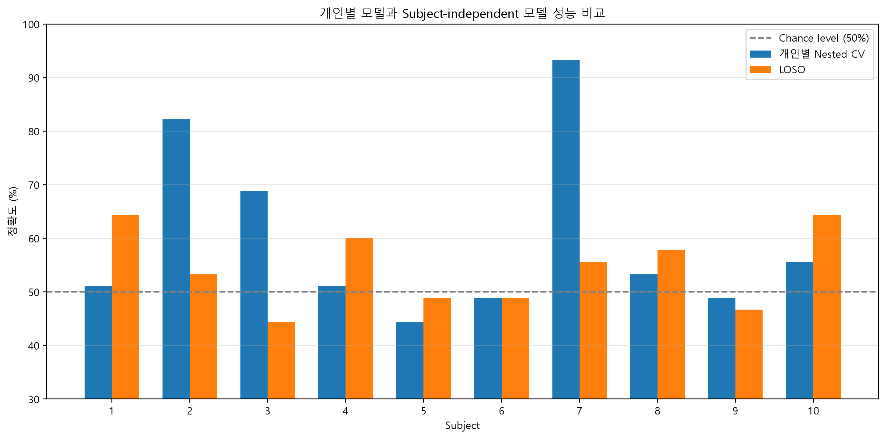
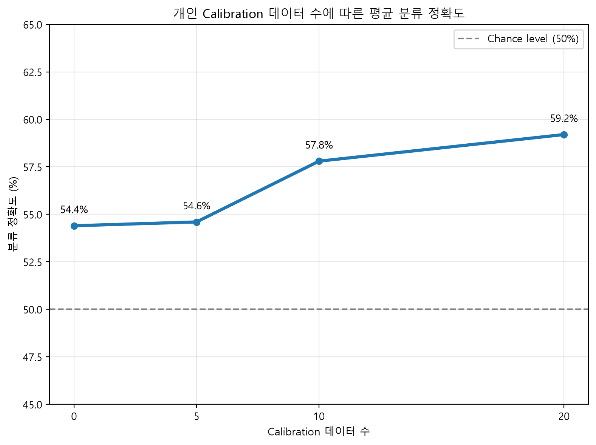
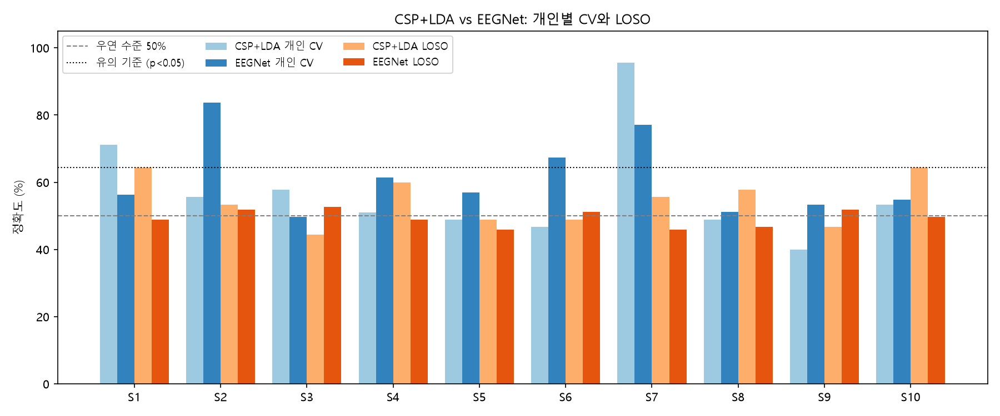
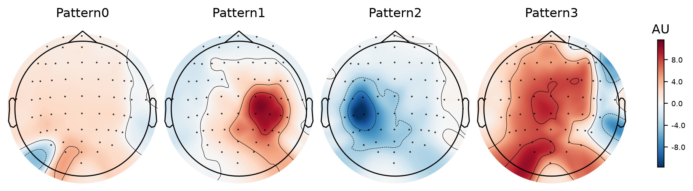

# EEG Motor Imagery BCI Classification

왼손/오른손 운동상상(Motor Imagery) EEG를 분류하는 BCI 포트폴리오 프로젝트입니다.  
PhysioNet EEG Motor Movement/Imagery Dataset(EEGBCI)을 사용해 전처리, CSP 특징 추출, LDA 분류, 개인별 평가, LOSO 평가, calibration 실험까지 진행했습니다.  
같은 조건에서 PyTorch로 구현한 EEGNet과도 비교했습니다.

## 프로젝트 목표

운동상상 EEG에서 왼손과 오른손 상태를 구분하고, **피험자 간 개인차가 분류 성능과 새로운 사용자에 대한 일반화 성능에 어떤 영향을 주는지** 확인합니다.

특히 다음 세 가지 질문을 중심으로 분석했습니다.

1. 개인별로 학습한 CSP + LDA 모델은 어느 정도의 분류 성능을 보이는가?
2. 여러 피험자의 데이터로 학습한 모델이 새로운 피험자에게도 일반화되는가?
3. 새로운 사용자의 소량 데이터를 추가하면 분류 성능을 개선할 수 있는가?

이를 확인하기 위해 subject-specific Nested Cross-Validation, Leave-One-Subject-Out(LOSO), personal calibration 실험을 순차적으로 비교했습니다.

## Dataset

- Dataset: PhysioNet EEG Motor Movement/Imagery Dataset (EEGBCI)
- Subjects: 1–10
- Runs: 4, 8, 12
- Task: Left fist vs Right fist motor imagery
- EEG channels: 64
- Sampling rate: 160 Hz
- Trials per subject: 45

원본 EEG 데이터는 저장소에 포함하지 않습니다.

## Pipeline

```text
EEGBCI EDF
    ↓
8–30 Hz Band-pass Filtering
    ↓
Event-based Epoching
    ↓
CSP (Common Spatial Patterns)
    ↓
LDA (Linear Discriminant Analysis)
    ↓
Left / Right Motor Imagery Classification
```

## Evaluation

### 1. Subject-specific classification

각 피험자에 대해 CSP + LDA 모델을 학습했습니다.

시간 구간과 CSP component 수를 비교한 뒤, 최종 성능 평가는 Nested Cross-Validation을 사용해 모델 선택과 성능 평가를 분리했습니다.

### 2. Subject-independent classification

Leave-One-Subject-Out(LOSO) 방식으로 한 명의 피험자를 완전히 제외하고 나머지 9명의 데이터로 모델을 학습한 뒤, 학습에 사용되지 않은 피험자를 평가했습니다.

이를 통해 새로운 사용자에 대한 subject-independent generalization 성능을 확인했습니다.

### 3. Personal calibration

LOSO 환경에서 새로운 사용자의 소량 EEG trial을 학습 데이터에 추가하여 개인별 calibration이 분류 성능에 미치는 영향을 비교했습니다.

## Results Summary

| Evaluation | Mean Accuracy | Interpretation |
|---|---:|---|
| Subject-specific Nested CV | 59.8% | 개인별 모델의 분류 성능 |
| LOSO | 54.4% | 새로운 피험자에 대한 일반화 성능 |
| LOSO + 5 calibration trials | 54.6% | 소량의 개인 데이터 추가 |
| LOSO + 10 calibration trials | 57.8% | 해당 calibration 조건에서 관찰된 평균 성능 |
| LOSO + 20 calibration trials | 59.2% | 해당 calibration 조건에서 관찰된 평균 성능 |

Subject-specific 모델에서는 평균 **59.8%**의 정확도를 보였지만, 완전히 새로운 피험자를 대상으로 한 LOSO에서는 평균 **54.4%**로 성능이 낮아졌습니다.

새로운 사용자의 calibration 데이터를 0개에서 20개로 늘렸을 때 평균 정확도는 **54.4%에서 59.2%로 관찰**되었습니다. 다만 피험자별 변화에는 차이가 있었으며, 조건별 평가 trial이 달라 개선 효과는 탐색적으로 해석했습니다.

이 결과는 EEG 기반 BCI에서 **피험자 간 차이(inter-subject variability)**가 새로운 사용자에 대한 일반화 성능을 제한할 수 있으며, 소량의 개인별 calibration 데이터가 이를 일부 보완할 가능성이 있음을 보여줍니다.

## Main Results

### Nested CV vs LOSO



Subject-specific Nested CV와 LOSO 결과를 피험자별로 비교했습니다.

- Mean subject-specific Nested CV accuracy: **59.8%**
- Mean LOSO accuracy: **54.4%**

일부 피험자는 개인별 모델에서 높은 분류 성능을 보였지만 새로운 피험자로 평가했을 때 성능이 크게 감소했습니다.

특히 CSP + LDA 실험에서 Subject 7의 개인별 Nested CV 정확도는 **93.3%**, 다른 9명의 데이터로 학습해 해당 피험자를 평가한 LOSO 정확도는 **55.6%**였습니다. 두 평가에서는 설정 선택 방식도 다르므로 이 차이를 피험자 간 차이만의 효과로 해석할 수는 없습니다.

이는 동일한 CSP + LDA 접근법에서도 피험자별 EEG 특성 차이가 모델의 일반화 성능에 큰 영향을 줄 수 있음을 보여주는 사례입니다.

### Calibration



전체 10명에 대한 calibration 결과는 다음과 같습니다.

| Calibration trials | Mean Accuracy |
|---:|---:|
| 0 | 54.4% |
| 5 | 54.6% |
| 10 | 57.8% |
| 20 | 59.2% |

개인 calibration 데이터가 증가하면서 관찰된 전체 평균 정확도는 높아졌습니다. 다만 조건별 평가 trial이 달라 동일한 테스트셋에서의 개선 효과로 단정할 수는 없습니다.

그러나 개선 정도에는 피험자별 차이가 있었습니다.

### Calibration example — Subject 7

Subject 7의 calibration 결과는 다음과 같습니다.

| Calibration trials | Accuracy |
|---:|---:|
| 0 | 55.6% |
| 5 | 61.5% |
| 10 | 69.4% |
| 20 | 76.8% |

Subject 7에서는 개인 데이터를 추가할수록 관찰된 정확도가 높아졌습니다.

이는 개인 데이터가 모델 적응에 기여할 가능성을 보여주는 사례이며, 조건별 평가 trial이 달라 해석에 주의가 필요합니다.

### EEGNet vs CSP + LDA



CSP + LDA와 **같은 데이터, 같은 전처리(8–30 Hz, 0–3초), 같은 5-fold 분할**로 EEGNet-8,2를 학습해 비교했습니다.  
신경망은 초기값에 따라 결과가 달라지므로 seed 3개의 평균을 사용했습니다.

| Model | 개인별 5-fold CV | LOSO |
|---|---:|---:|
| CSP + LDA (0–3초, CSP 4개 고정) | 56.9% | 54.4% |
| EEGNet | 61.2% | 49.3% |

- 개인별 CV에서는 EEGNet 평균이 조금 높았지만, 피험자마다 더 나은 모델이 달랐습니다. (예: Subject 2는 EEGNet 83.7% vs CSP + LDA 55.6%, Subject 7은 77.0% vs 95.6%)
- LOSO에서는 EEGNet도 평균 49.3%로 우연 수준에 머물렀고, 개인 CV에서 77.0%였던 Subject 7도 45.9%로 떨어졌습니다.
- 즉 처음 보는 피험자에 대한 일반화 문제는 **분류 모델을 바꾸는 것만으로 해결되지 않았습니다.**
- 독립적인 45회 시행과 정답 확률 0.5를 가정한 단측 이항검정(p < 0.05)의 기준은 29/45(약 64.4%)입니다. 다만 CV 결과와 seed 평균에 이 기준을 그대로 적용해 통계적 유의성을 단정할 수는 없으므로 참고 기준으로만 사용합니다.

Subject 1 한 명으로 처음 구현한 EEGNet 베이스라인은 `notebooks/eegnet_baseline_subject1.ipynb`에 있습니다. (학습 36 / 테스트 9 trial, 1회 분할)

### CSP Spatial Patterns



Subject 7의 CSP spatial pattern을 topomap으로 시각화했습니다.

CSP는 두 클래스의 분산 차이를 크게 만드는 공간 필터를 학습하며, 이를 통해 좌/우 운동상상 분류에 사용되는 EEG의 공간적 패턴을 확인할 수 있습니다.

## Interpretation

이번 프로젝트에서 확인한 핵심 내용은 다음과 같습니다.

- 운동상상 EEG 분류 성능은 피험자에 따라 크게 달랐습니다.
- 개인별 평가에서 높은 정확도를 보인 피험자도 LOSO에서는 낮은 정확도를 보일 수 있었습니다.
- 개인별 Nested CV와 고정 설정 LOSO는 설정 선택 방식도 달라, 성능 차이를 피험자 간 차이만의 효과로 해석할 수는 없습니다.
- Calibration 데이터를 추가한 조건에서 평균 정확도가 높아졌지만, 피험자별 변화와 조건별 평가 trial 차이를 함께 고려해야 합니다.
- EEGNet은 개인별 CV에서 CSP + LDA보다 평균 정확도가 높았지만, LOSO에서는 두 모델 모두 새로운 피험자에 대한 일반화에 한계를 보였습니다.

이 결과는 EEG 기반 BCI에서 **피험자 간 일반화와 개인별 보정(calibration)**을 함께 검토할 필요가 있음을 시사합니다.

## Limitations

- 피험자당 trial 수가 45개로 적습니다.
- 분석 대상은 Subject 1–10으로 제한했습니다.
- CSP + LDA와 기본 구조의 EEGNet만 비교했습니다. CSP + LDA는 개인별 Nested CV에서 시간 구간과 CSP component 수를 탐색했으며, EEGNet 비교에는 고정 설정의 CSP + LDA를 사용했습니다. EEGNet의 하이퍼파라미터는 고정했습니다.
- EEGNet 개인별 CV는 학습 trial이 36개뿐이라 검증셋 없이 고정 epoch(200)로 학습했습니다.
- EEGNet LOSO의 early stopping 검증셋은 학습 피험자 9명의 trial을 섞어 무작위로 나눴습니다. 피험자 단위로 검증셋을 나누면 새로운 피험자에 대한 일반화를 더 잘 반영할 수 있습니다.
- Calibration 데이터가 증가할수록 평가에 남는 개인 test trial 수가 감소합니다.
- Calibration 조건별 test set 크기가 동일하지 않으므로 결과를 직접적으로 동일 조건의 성능 비교로 해석하는 데 한계가 있습니다.
- 본 프로젝트는 포트폴리오용 탐색적 분석이며 임상적 성능을 주장하지 않습니다.

## Project Structure

```text
eeg-motor-imagery-bci/
├── README.md
├── requirements.txt
├── .gitignore
├── notebooks/
│   ├── bci_analysis.ipynb               # CSP + LDA, Nested CV, LOSO, calibration
│   ├── eegnet_baseline_subject1.ipynb   # EEGNet 첫 구현 (Subject 1)
│   └── eegnet_analysis.ipynb            # EEGNet 10명 확장, CSP + LDA와 비교
├── results/
│   └── eegnet_results.csv
└── figures/
    ├── nested_vs_loso.png
    ├── calibration_curve.png
    ├── csp_patterns.png
    └── eegnet_vs_csp.png
```

## Environment

Main packages:

- Python 3.13
- MNE-Python 1.12.1
- PyTorch 2.6.0 (CUDA 12.4, RTX 4060)
- NumPy
- SciPy
- scikit-learn
- pandas
- matplotlib
- Jupyter Notebook

Install dependencies:

```bash
pip install -r requirements.txt
# GPU로 EEGNet을 학습하려면 CUDA 버전 PyTorch 설치
pip install torch --index-url https://download.pytorch.org/whl/cu124
```

## Run

```bash
jupyter notebook
```

Open:

```text
notebooks/bci_analysis.ipynb
notebooks/eegnet_analysis.ipynb
```

EEGBCI data is expected at:

```text
D:\bci_data
```

If using another path, change `DATA_PATH` in the notebook.

## Future Work

- More subjects
- Frequency-band comparison
- Channel-selection experiments
- Improved calibration strategy
- Subject-wise validation split for EEGNet LOSO
- Resting-state EEG features vs cross-subject performance
- Cross-session / cross-subject generalization analysis
